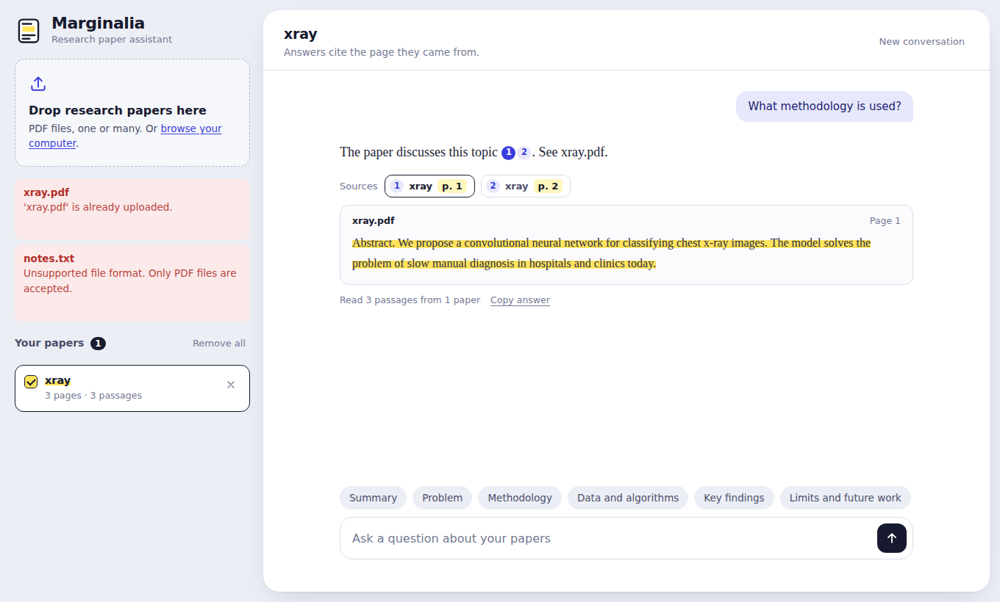

# Marginalia: Research Paper Assistant (RAG)

Upload one or more research papers (PDF) and ask questions about them. Answers are generated
**only from the uploaded documents** and every answer shows the **document name and page number**
it came from. If the papers don't contain the answer, the assistant says so.

**Stack:** Python, FastAPI, LangChain, ChromaDB, Google Gemini (LLM + embeddings), plain HTML/CSS/JS frontend.



## Submission documents

In the `docs/` folder: `Project_Report.pdf` (detailed report), `Presentation.pptx` and `Presentation.pdf` (slides).

## Features

- Upload multiple PDFs at once (drag and drop or file picker); duplicates are detected
- Page-aware text extraction, chunking, embeddings and persistent storage in ChromaDB
- Chat interface with follow-up questions (conversation history is condensed into a standalone query)
- Numbered inline citations `[1]`, plus a *Sources* row showing **file name + page** for each answer
- Click a citation to see the exact retrieved passage, highlighted
- Choose which papers to ask about (tick or untick papers on the shelf)
- Summary questions read passages spread across the whole paper (intro to conclusion)
- Strict grounding: a `NOT_FOUND` rule in the prompt makes the app answer *"not available in the uploaded documents"*
- Graceful handling of: no document uploaded, empty question, unsupported file type, fake `.pdf`,
  corrupted / password-protected / scanned PDFs, oversize files, missing API key, rate limits
- Responsive layout (works on phones), keyboard accessible, respects reduced-motion

## How it works

```
PDF -> pypdf (per page) -> clean text -> RecursiveCharacterTextSplitter (1000 / 150)
    -> Gemini embeddings -> ChromaDB (metadata: file, page, chunk, doc_id)

Question -> (condense with history) -> embed -> top-k similarity search (filtered to selected papers)
         -> numbered context [1..n] -> Gemini with strict "answer only from context" prompt
         -> answer with [n] citations -> map citations to {file, page, passage}
```

Project layout:

```
app/
  main.py        FastAPI routes + static frontend
  rag.py         ingestion, retrieval, generation
  pdf_utils.py   upload validation, page text extraction
  prompts.py     system prompt and templates
  registry.py    JSON list of indexed papers
  config.py      environment settings
frontend/        index.html, style.css, app.js (served by FastAPI)
tests/           pytest suite (offline, uses fake embeddings + fake LLM)
```

## Run it locally

Requires Python 3.10+ and a free Gemini API key from <https://aistudio.google.com/apikey>.

```bash
git clone <your-repo-url> && cd research-paper-assistant
python -m venv .venv
source .venv/bin/activate          # Windows: .venv\Scripts\activate
pip install -r requirements.txt

cp .env.example .env               # Windows: copy .env.example .env
# open .env and paste your key:  GOOGLE_API_KEY=...

uvicorn app.main:app --reload
```

Open <http://127.0.0.1:8000>. Interactive API docs are at <http://127.0.0.1:8000/docs>.

If a model name has been retired, change `GEMINI_CHAT_MODEL` / `GEMINI_EMBEDDING_MODEL` in `.env`.

## API

| Method | Path | Purpose |
|---|---|---|
| GET | `/api/health` | status, whether the API key is configured |
| GET | `/api/documents` | list indexed papers |
| POST | `/api/documents` | upload PDFs (`multipart/form-data`, field `files`, repeatable) |
| DELETE | `/api/documents/{id}` | remove one paper and its vectors |
| DELETE | `/api/documents` | remove all papers |
| POST | `/api/chat` | `{ "question": "...", "doc_ids": [..], "history": [..] }` |

Example:

```bash
curl -F "files=@paper.pdf" http://127.0.0.1:8000/api/documents
curl -X POST http://127.0.0.1:8000/api/chat -H "Content-Type: application/json" \
     -d '{"question": "What datasets and algorithms are used?"}'
```

Chat response:

```json
{
  "answer": "The authors train a ResNet-50 on ChestXray14 [1] ...",
  "found": true,
  "sources": [{"id": 1, "document": "paper.pdf", "doc_id": "a1b2c3", "page": 4, "snippet": "..."}],
  "passages_read": 8,
  "documents_searched": 1
}
```

## Tests

```bash
pip install -r requirements-dev.txt
pytest -q
```

The tests run fully offline with deterministic fake embeddings and a fake LLM. They cover upload validation,
page numbers in sources, summary retrieval, the not-found path, duplicates, deletion, multi-paper
selection, follow-ups and a missing API key.

## Design decisions

- **Page-level chunking.** Each page is split separately so every chunk carries an exact page number.
- **Citations by number.** The model cites `[n]`; the backend maps numbers back to real file and page metadata,
  so a page number is never generated by the model.
- **Not-found rule.** The model must answer `NOT_FOUND` when the excerpts don't cover the question; the API then
  returns `found: false` with no sources.
- **Prompt-injection hygiene.** Excerpts are labelled as untrusted data in the system prompt.
- **Cosine similarity** in Chroma; `top_k` defaults to 8 and is configurable.

## Limitations

- Scanned (image-only) PDFs need OCR, which is not included.
- Tables and equations extracted from PDFs can lose their layout.
- Gemini free-tier rate limits can slow indexing of very large papers (the app retries with back-off).
